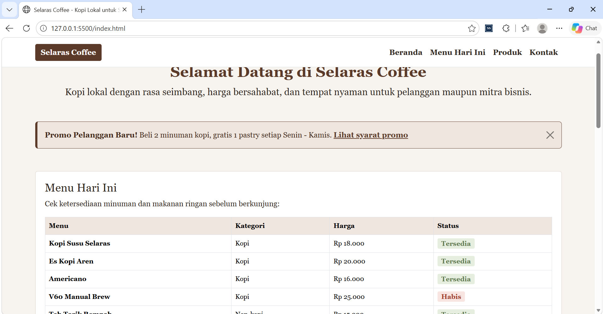
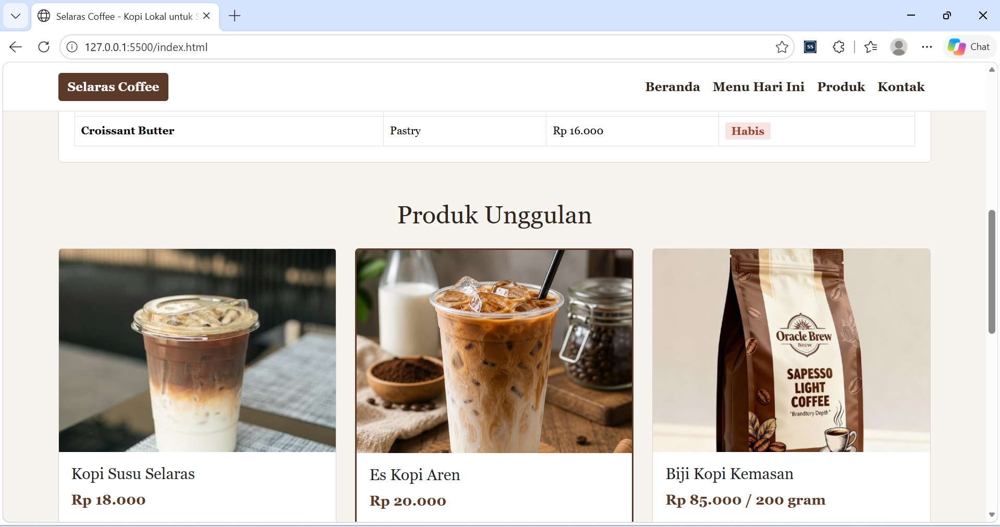
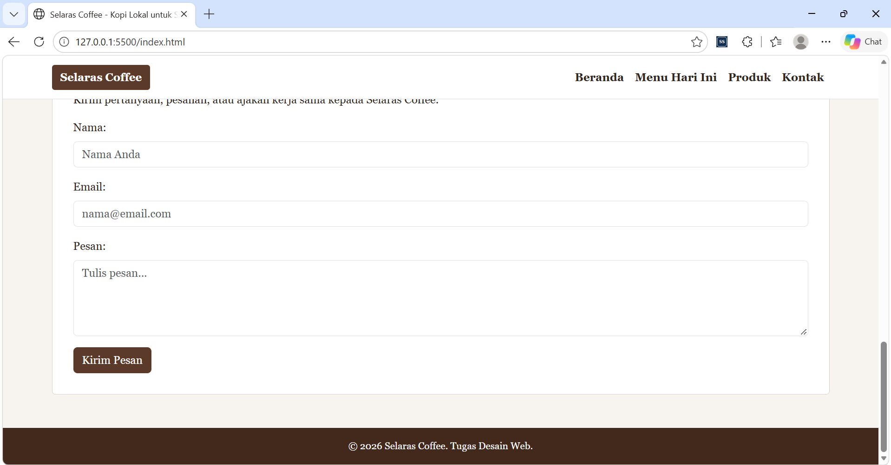
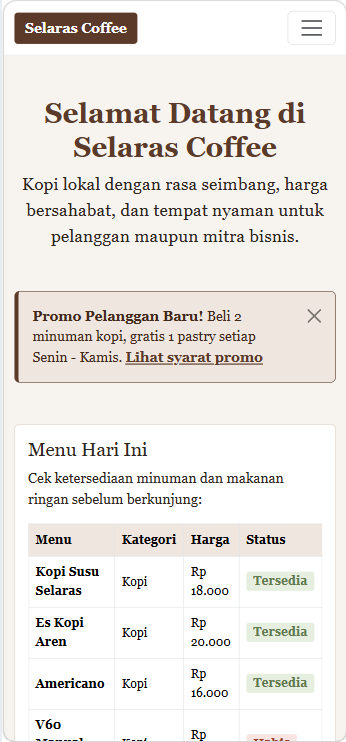
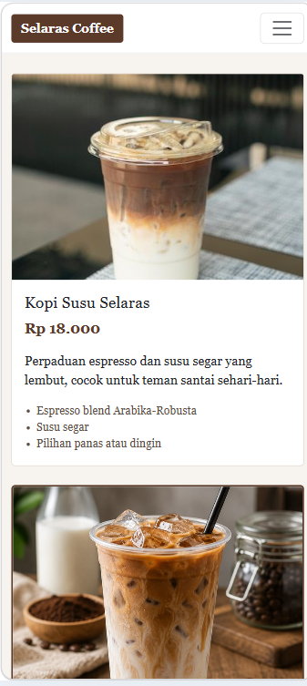
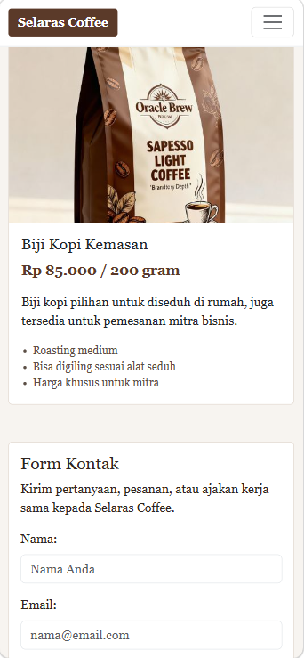

# One Page Website – Selaras Coffee

| | |
|---|---|
| **Nama** | Prevansyah Sjafar |
| **NPM** | 4525210057 |
| **Mata Kuliah** | Desain Web |
| **Kelas** | A |
| **Tugas** | Tugas pertemuan 9 – Website Company Profile / UMKM (One Page Website) |
| **Studi kasus** | UMKM Selaras Coffee |


## Gambaran Singkat

Website satu halaman berbasis **Bootstrap 5** (via CDN) untuk UMKM **Selaras Coffee**, dibuat agar bisa dipresentasikan kepada calon pelanggan dan mitra bisnis. Halaman menampilkan informasi usaha, notifikasi promo, menu hari ini beserta ketersediaannya, produk unggulan, form kontak, dan footer. Komponen dasar memakai Bootstrap 5, lalu identitas visual diberikan lewat CSS buatan sendiri (`css/style.css`) dengan warna cokelat espresso `#5b3a29` dan hijau sage `#5f7a4f`.

## Struktur Folder

```
├── index.html        → struktur halaman
├── css/style.css     → custom CSS (identitas & responsif)
├── img/              → screenshot desktop & mobile
│   └── src/          → foto produk (ESKOPISUSU.jpg, ESKOPISUSUGULAAREN.jpg, bijikopi.jpg)
|   └── ss/          → foto output
└── readme.md
```

## Pemetaan Ketentuan Tugas ke Kode

| No | Ketentuan | Status | Lokasi di kode | Penjelasan singkat |
|---|---|---|---|---|
| 1 | Navbar responsif | Ada (Bootstrap) | `index.html` dan `style.css` | Memakai `navbar navbar-expand-md` dengan tombol hamburger (`navbar-toggler`) dan `collapse navbar-collapse`. Di layar ≥ 768px menu tampil horizontal, di layar kecil menjadi hamburger. Menu: Beranda, Menu Hari Ini, Produk, Kontak. Logo `.brand-box` dan warna link diatur di CSS sendiri. |
| 2 | Hero section | Ada | `index.html` dan `style.css` | Blok `.hero` (class Bootstrap `text-center py-5`, `lead`) berisi judul "Selamat Datang di Selaras Coffee" dan deskripsi singkat untuk pelanggan dan mitra bisnis. |
| 3 | Minimal 3 card | Ada (3 card) | `index.html` dan `style.css` | Tiga `card` Bootstrap (`card-img-top`, `card-body`, `card-title`, `h-100`): Kopi Susu Selaras, Es Kopi Aren, dan Biji Kopi Kemasan. Setiap card punya foto produk dari `img/src/`, diseragamkan tingginya lewat `.card-foto` (`object-fit: cover`). Ditata dengan grid `row g-4` + `col-12 col-md-4` (3 kolom di desktop, 1 kolom di mobile). Card tengah memakai `.card-utama` (border cokelat tebal) sebagai produk unggulan. |
| 4 | Minimal 1 alert | Ada (Bootstrap) | `index.html` dan `style.css` | Alert promo "Beli 2 minuman kopi, gratis 1 pastry" memakai `alert alert-dismissible fade show` dengan tombol `btn-close` untuk menutup. Letaknya di bawah hero. Gaya cokelat dibuat lewat `.alert-selaras` di CSS sendiri. |
| 5 | Minimal 1 modal | Ada (Bootstrap) | `index.html` dan `style.css` | Modal `#modalPromo` berisi syarat dan ketentuan promo. Dibuka lewat link "Lihat syarat promo" di alert (`data-bs-toggle="modal"`, `data-bs-target="#modalPromo"`). Header cokelat memakai `.modal-header-selaras`, dan tombol "Tanya Kami" mengarah ke form kontak. |
| 6 | Form kontak | Ada (Bootstrap) | `index.html` dan `style.css` | Form memakai `form-label`, `form-control`, dan tombol `btn btn-selaras`. Berisi input Nama, Email, textarea Pesan (semuanya `required`), dan tombol "Kirim Pesan". Warna fokus input dan tombol disesuaikan ke cokelat lewat CSS sendiri. |
| 7 | Footer | Ada | `index.html` dan `style.css` | Footer cokelat gelap berisi teks hak cipta Selaras Coffee, rata tengah (`text-center py-3`). |
| 8 | Custom CSS (branding) | Ada | `css/style.css` (seluruh file) | Variabel warna `--selaras-cokelat` (`#5b3a29`) dipakai pada `.brand-box`, `.harga`, `.card-utama`, `.btn-selaras`, fokus form, header modal, dan footer. Badge `.status-tersedia` memakai hijau sage dan `.status-habis` memakai merah sebagai pembeda status. Font serif (Georgia) dipakai untuk memberi kesan hangat khas kedai kopi. File dimuat setelah Bootstrap agar bisa menimpa gaya bawaan. |
| 9 | Bootstrap 5 | Ada | `<head>` dan akhir `<body>` di `index.html` | CSS Bootstrap 5.3.3 dimuat lewat CDN di `<head>`, dan `bootstrap.bundle.min.js` di akhir `<body>` untuk fungsi hamburger navbar, alert, dan modal. |

## Komponen Tambahan

**Menu Hari Ini** (`index.html` dan `style.css`): tabel menu berisi 7 item (kopi: Kopi Susu Selaras, Es Kopi Aren, Americano, V60 Manual Brew; non-kopi: Teh Tarik Rempah, Matcha Latte; pastry: Croissant Butter) dengan kolom nama, kategori, harga, dan status Tersedia / Habis. Tabel memakai class Bootstrap `table table-bordered` dan dibungkus `table-responsive` sehingga bisa digeser horizontal di layar kecil.

## Bagian Responsif (Mobile)

Sebagian besar ditangani oleh Bootstrap, ditambah sedikit penyesuaian di `style.css`:

- Navbar berubah menjadi hamburger di bawah 768px (`navbar-expand-md`).
- Tiga card tersusun vertikal di mobile (`col-12 col-md-4`).
- Tabel menu bisa digeser ke samping (`table-responsive`).
- Padding section menu dan kontak dikecilkan lewat media query di `style.css`.

## Bukti yang Dikumpulkan

1. **Source code:** `index.html` dan `css/style.css`.
2. **Screenshot desktop dan mobile:** folder `img/` (lihat di bawah).
3. **Penjelasan perubahan, masalah, dan solusi:** dijelaskan pada bagian pemetaan di atas.
4. **Pembagian peran:** tugas individu, seluruh pekerjaan dikerjakan sendiri.

## Hasil Output

Tampilan desktop





Tampilan mobile



