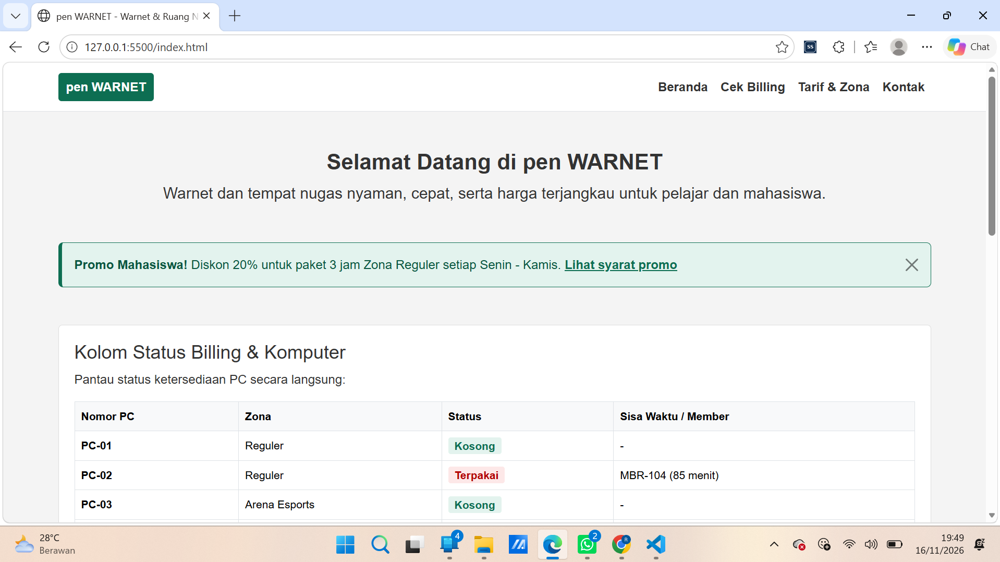
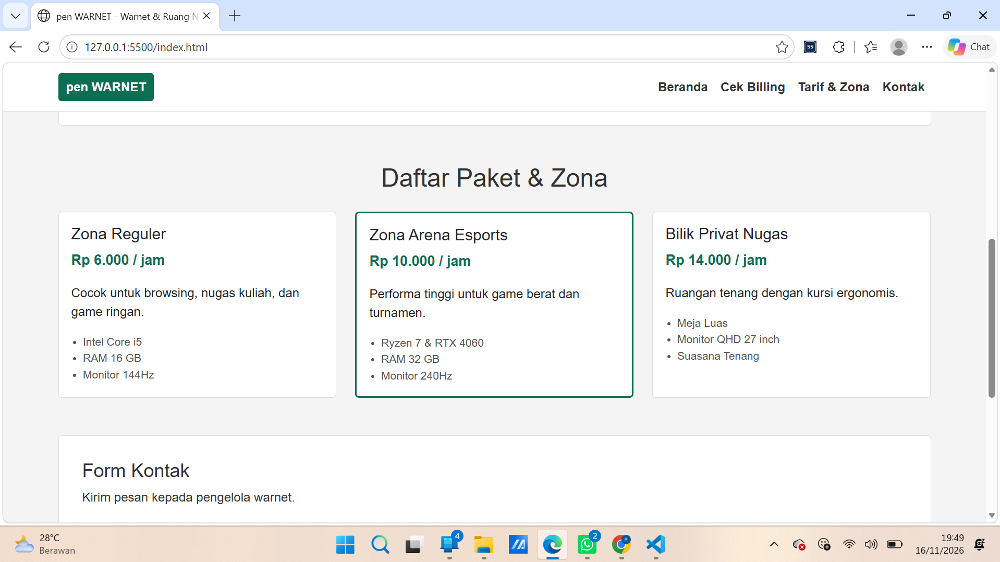
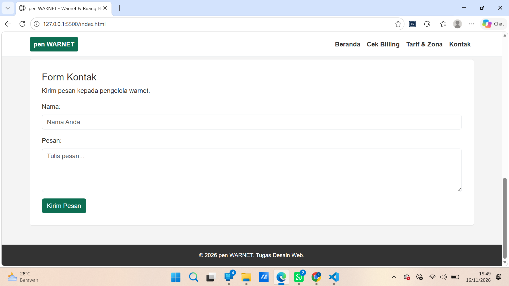
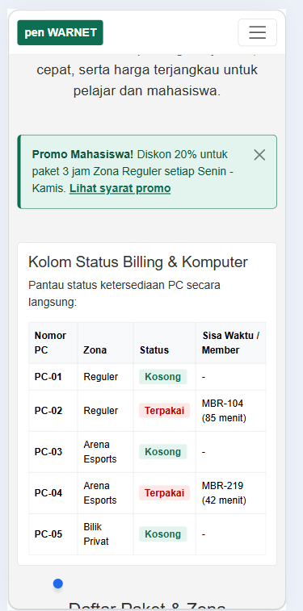
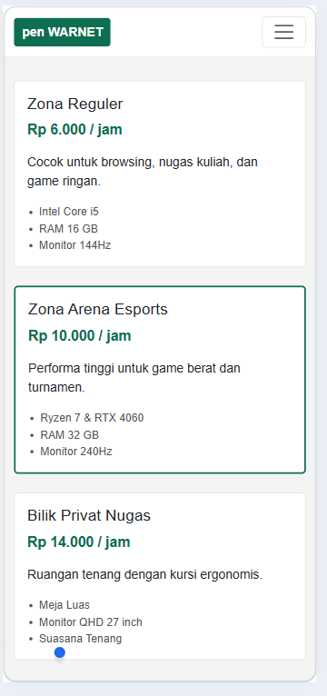
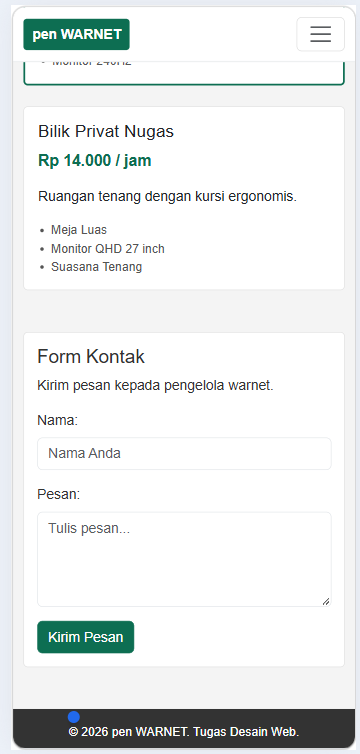

# One Page Website – pen WARNET

| | |
|---|---|
| **Nama** | Prevansyah Sjafar |
| **NPM** | 4525210057 |
| **Mata Kuliah** | Desain Web |
| **Kelas** | A |
| **Tugas** | pertemuan 09 |

## Gambaran Singkat

Website satu halaman berbasis **Bootstrap 5** (via CDN) untuk usaha warnet dan ruang nugas bernama **pen WARNET**. Halaman menampilkan informasi usaha, status PC secara langsung, daftar paket dan zona beserta tarifnya, form kontak, dan footer. Komponen dasar memakai Bootstrap 5, lalu identitas visual diberikan lewat CSS buatan sendiri (`css/style.css`) dengan warna hijau `#0d6e52` sebagai branding utama.

## Pemetaan Ketentuan Tugas ke Kode

| No | Ketentuan | Status | Lokasi di kode | Penjelasan singkat |
|---|---|---|---|---|
| 1 | Navbar responsif | Ada (Bootstrap) | `index.html` dan `style.css` | Memakai `navbar navbar-expand-md` dengan tombol hamburger (`navbar-toggler`) dan `collapse navbar-collapse`. Di layar ≥ 768px menu tampil horizontal, di layar kecil menu menjadi hamburger. Logo `.brand-box` dan warna link diatur di CSS sendiri. |
| 2 | Hero section | Ada | `index.html` dan `style.css` | Blok `.hero` (class Bootstrap `text-center py-5`, `lead`) berisi judul "Selamat Datang di pen WARNET" dan deskripsi singkat. |
| 3 | Minimal 3 card | Ada (3 card) | `index.html` dan `style.css` | Tiga `card` Bootstrap (`card-body`, `card-title`, `h-100`): Zona Reguler, Zona Arena Esports, dan Bilik Privat Nugas. Ditata dengan grid `row g-4` + `col-12 col-md-4` (3 kolom di desktop, 1 kolom di mobile). Card tengah memakai `.card-utama` (border hijau tebal) sebagai paket unggulan. |
| 4 | Minimal 1 alert | Ada (Bootstrap) | `index.html` dan `style.css` | Alert promo mahasiswa memakai `alert alert-dismissible fade show` dengan tombol `btn-close` untuk menutup. Letaknya di bawah hero. Gaya hijau dibuat lewat `.alert-warnet` di CSS sendiri. |
| 5 | Minimal 1 modal | Ada (Bootstrap) | `index.html` dan `style.css` | Modal `#modalPromo` berisi syarat dan ketentuan promo. Dibuka lewat link "Lihat syarat promo" di alert (`data-bs-toggle="modal"`, `data-bs-target="#modalPromo"`). Header hijau memakai `.modal-header-warnet`, dan tombol "Tanya Pengelola" mengarah ke form kontak. |
| 6 | Form kontak | Ada (Bootstrap) | `index.html` dan `style.css` | Form memakai `form-label`, `form-control`, dan tombol `btn btn-warnet`. Berisi input Nama, textarea Pesan, dan tombol "Kirim Pesan". Warna fokus input dan tombol disesuaikan ke hijau lewat CSS sendiri. |
| 7 | Footer | Ada | `index.html` dan `style.css` | Footer gelap (`#333`) berisi teks hak cipta, rata tengah (`text-center py-3`). |
| 8 | Custom CSS (branding) | Ada | `css/style.css` (seluruh file) | Variabel warna `--warnet-hijau` (`#0d6e52`) dipakai pada `.brand-box`, `.harga`, `.card-utama`, `.btn-warnet`, fokus form, dan badge `.status-kosong`. Badge `.status-pakai` memakai merah sebagai pembeda status. File dimuat setelah Bootstrap agar bisa menimpa gaya bawaan. |
| 9 | Bootstrap 5 | Ada | `<head>` dan akhir `<body>` di `index.html` | CSS Bootstrap 5.3.3 dimuat lewat CDN di `<head>`, dan `bootstrap.bundle.min.js` di akhir `<body>` untuk fungsi hamburger navbar. |

## Komponen Tambahan

**Kolom status billing** (`index.html` dan `style.css`): tabel status PC (PC-01 sampai PC-05) lengkap dengan zona, status (Kosong / Terpakai), dan sisa waktu member. Tabel memakai class Bootstrap `table table-bordered` dan dibungkus `table-responsive` sehingga bisa digeser horizontal di layar kecil.

## Bagian Responsif (Mobile)

Sebagian besar ditangani oleh Bootstrap, ditambah sedikit penyesuaian di `style.css`:

- Navbar berubah menjadi hamburger di bawah 768px (`navbar-expand-md`).
- Tiga card tersusun vertikal di mobile (`col-12 col-md-4`).
- Tabel billing bisa digeser ke samping (`table-responsive`).
- Padding section billing dan kontak dikecilkan lewat media query di `style.css`.

## Hasil Output

Tampilan desktop

Tampilan mobile

